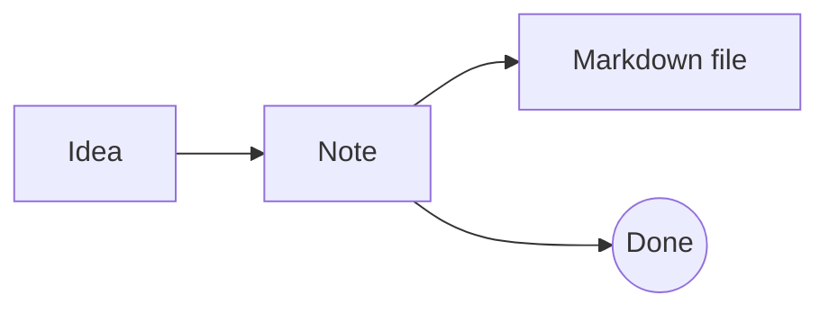
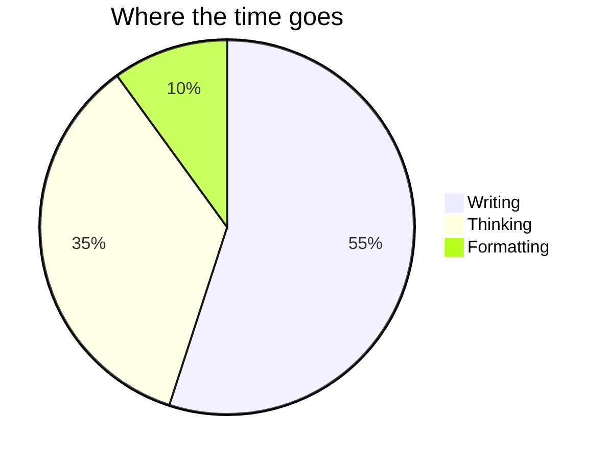

# Code and diagrams

Write the language after the three backticks for syntax highlighting in your theme's colors:

```ts
function greet(name: string) {
  return `Hello, ${name}!`;
}
```

```sql
select title, updated from notes where pinned order by updated desc;
```

Hover a block for a copy button. The wand next to it tidies the code. Try it on this one-line JSON:

```json
{"name":"lines","features":["markdown","callouts","tables","diagrams"],"local":true}
```

## Diagrams

A `mermaid` code block is drawn as a diagram. Click it to edit the code, and the diagram follows as you type.





#tour
