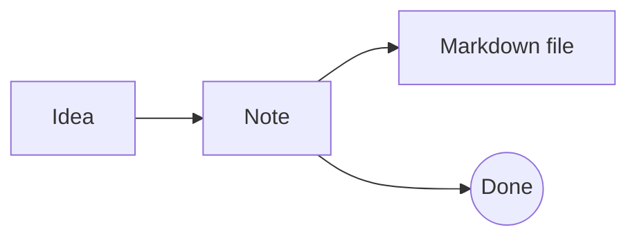
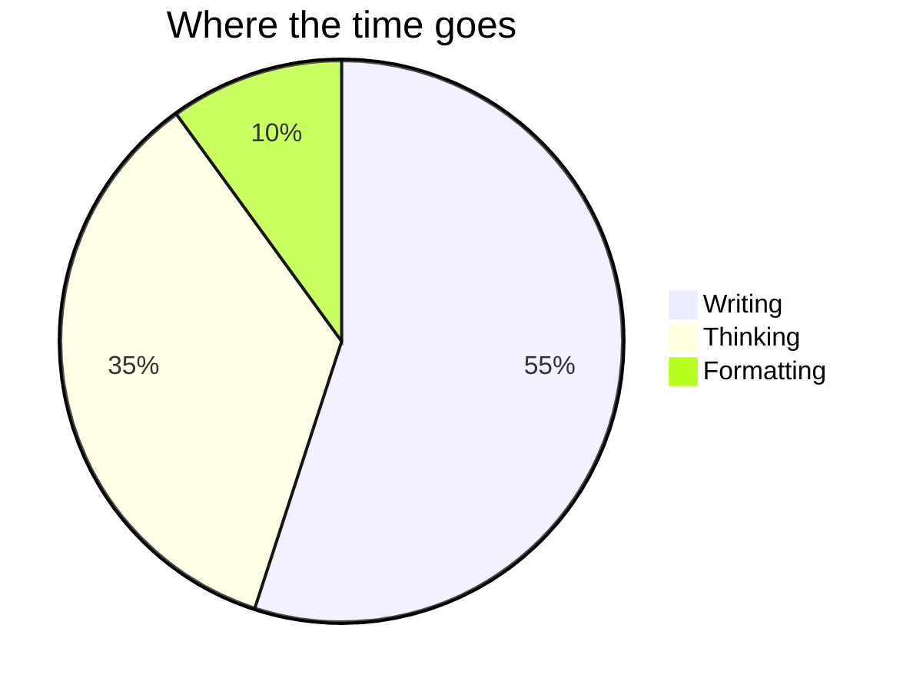

# Code, diagrams, models and math

Write the language after the three backticks for syntax highlighting in your theme's colors:

```ts
function greet(name: string) {
  return `Hello, ${name}!`;
}
```

```sql
select title, updated from notes where pinned order by updated desc;
```

Hover a block for a copy button. The wand next to it tidies the code. Try it on this one-line JSON:

```json
{"name":"lines","features":["markdown","callouts","tables","diagrams"],"local":true}
```

## Diagrams

A `mermaid` code block is drawn as a diagram. Click it to edit the code, and the diagram follows as you type. Drag its corner to make it bigger or smaller. To arrange one by hand, hover it and use its shapes button, Copy and Edit as Drawing: the copy opens as a drawing below, and the code stays.





## Timing diagrams

For electronics, a `wavedrom` code block draws signals over time with [WaveDrom](https://wavedrom.com): each character of a `wave` is a clock cycle. Type `/timing` for one.

```wavedrom
{ signal: [
  { name: "clk",   wave: "p.......|.." },
  { name: "req",   wave: "0.1...0.|.." },
  { name: "data",  wave: "x..3.4.x|5x", data: ["addr", "data", "next"] },
  { name: "ready", wave: "0....10.|1." }
] }
```

It draws a register's bit fields too, like this one, and logic circuits (`assign`).

```wavedrom
{ reg: [
  { bits: 8, name: "data" },
  { bits: 4, name: "addr", type: 4 },
  { bits: 3, name: "flags", type: 5 },
  { bits: 1, name: "en", type: 2 }
] }
```

## 3D models

An `openscad` code block is [OpenSCAD](https://openscad.org) code, drawn as the model it makes. Drag it to turn it around, pinch (or hold ⌘ and scroll) to zoom, and click it to change its numbers: the model follows as you type. Its button downloads it as an STL file, ready for a 3D printer. Type `/model` to start one.

```openscad
// A pencil cup: try a taller one, or more holes.
height = 40;
radius = 18;
holes = 10;

difference() {
  cylinder(h = height, r = radius, $fn = 64);
  translate([0, 0, 2]) cylinder(h = height, r = radius - 2, $fn = 64);
  for (i = [0 : holes - 1])
    rotate([0, 0, i * 360 / holes])
      translate([radius, 0, height / 2])
        rotate([0, 90, 0]) cylinder(h = 6, r = 4, center = true, $fn = 24);
}
```

## Drawings

Type `/drawing` to sketch in [Excalidraw](https://excalidraw.com): boxes, arrows, handwriting. The check mark at the top right (⌘S) puts it in the note as an image that other Markdown apps show too. Double-click it, or use its pencil button, to draw more; undo brings back the drawing before.


## Math

LaTeX between dollar signs is drawn as math, within text like $e^{i\pi} + 1 = 0$, or in a block between `$$` lines. Click it to edit, and the math follows as you type. `/math` starts a block, and a backslash inside math opens a menu of commands: `\fr` finds `\frac`, and Tab moves between its braces.

$$
\hat f(\xi) = \int_{-\infty}^{\infty} f(x)\, e^{-2\pi i x \xi}\, dx
$$

#tour
